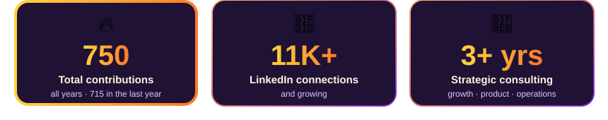
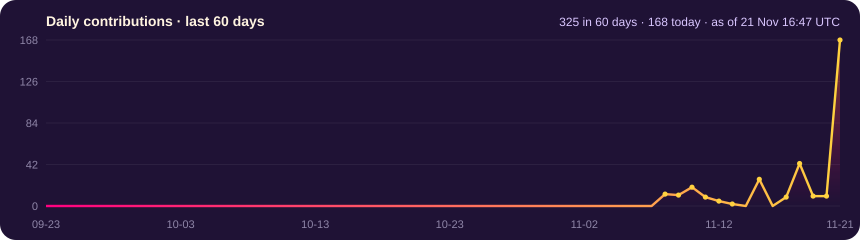
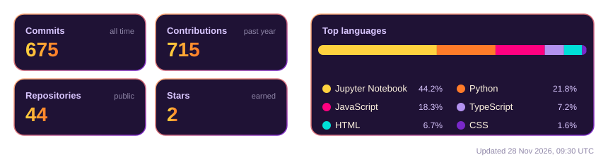
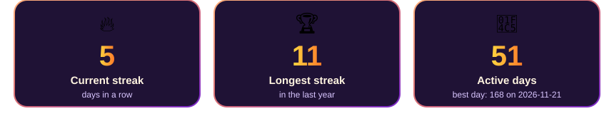
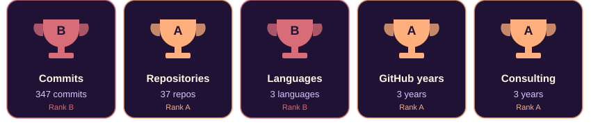

<!-- ===================== BANNER ===================== -->

  

  

  

  
  
  

<!-- ===================== CONTRIBUTIONS (up front) ===================== -->
<h2>🔥 Contributions</h2>

  

  

<!-- ===================== ABOUT ===================== -->
<h2> About me</h2>

I'm a **Strategic Consultant** and the **Head of Strategic Growth, Product & Operations at SyncroVox AI** *(Vocal Labs AI)*.

I sit where strategy meets execution: I find where the growth is, shape the product that captures it, and build the operations that let it scale. Every call is backed by data, from market sizing and pricing to dashboards and forecasts, and I'm currently exploring how **Agentic AI** changes the way products and teams work.

<table align="center">
  <tr>
    <td align="center"> <b>Strategic Consultant</b></td>
    <td align="center"> <b>Growth</b></td>
    <td align="center"> <b>Product</b></td>
    <td align="center"> <b>Operations</b></td>
    <td align="center"> <b>Analytics</b></td>
    <td align="center"> <b>Agentic AI</b></td>
    <td align="center"> <b>MBA</b></td>
    <td align="center"> <b>UN Delegate</b></td>
    <td align="center"> <b>Chai- powered</b></td>
  </tr>
</table>

<i>“Find the growth, build the product, run the machine, prove it with data.”</i>

<!-- ===================== TECH ===================== -->
<h2>🛠️ Toolkit</h2>

  

  
  
  
  
  
  

<!-- ===================== STATS ===================== -->
<h2>🔥 GitHub in numbers</h2>

  

  

  

<!-- ===================== GAMES ===================== -->
<h2>👾 Pac-Man vs. my contributions</h2>

  <picture>
    <source media="(prefers-color-scheme: dark)" srcset="https://raw.githubusercontent.com/anshumantewary-pm/anshumantewary-pm/output/pacman-contribution-graph-dark.svg?v=f2ec031287" />
    
  </picture>

<!-- ===================== CONNECT ===================== -->
<h2>🤝 Let's build something</h2>

  <b>Open to conversations on growth strategy, product and operations, especially in AI.</b>  
  
  

  

