<!-- ===================== BANNER ===================== -->

  

  

  

  
  
  

<!-- ===================== ABOUT ===================== -->
<h2>⚡ About me</h2>

I'm a **Strategic Consultant** who turns ambiguous business problems into clear plans, sharp numbers and things that ship.

- 🚀 **Now:** Head of **Strategic Growth, Product & Operations** at **SyncroVox AI** *(Vocal Labs AI)*
- 🧠 **I do:** growth strategy, product direction, operating models and go-to-market
- 📊 **I use:** data analytics, financial modelling and AI to back every call with evidence
- 🤖 **Exploring:** Agentic AI and how it reshapes products and operations
- 🎓 **MBA**
- 🌍 **Beyond work:** UN delegate, life explorer, always one chai away from the next idea

 

<!-- ===================== WHAT I BRING ===================== -->
<h2>🎯 What I bring</h2>

<table>
  <tr>
    <td align="center" width="25%">🧭 <b>Strategy</b> Market entry, pricing, growth plans</td>
    <td align="center" width="25%">📦 <b>Product</b> Roadmaps, prioritisation, launch</td>
    <td align="center" width="25%">⚙️ <b>Operations</b> Processes, KPIs, scale</td>
    <td align="center" width="25%">📈 <b>Analytics</b> Dashboards, forecasting, models</td>
  </tr>
</table>

<!-- ===================== TECH ===================== -->
<h2>🛠️ Toolkit</h2>

  

  
  
  
  
  
  

<!-- ===================== STATS ===================== -->
<h2>🔥 GitHub in numbers</h2>

  
  

  

  

<!-- ===================== GAMES ===================== -->
<h2>🎮 Arcade: my contributions vs. the classics</h2>

<b>👾 Pac-Man</b>

  <picture>
    <source media="(prefers-color-scheme: dark)" srcset="https://raw.githubusercontent.com/anshumantewary-pm/anshumantewary-pm/output/pacman-contribution-graph-dark.svg" />
    
  </picture>

<b>🧱 Breakout</b>

  <picture>
    <source media="(prefers-color-scheme: dark)" srcset="https://raw.githubusercontent.com/anshumantewary-pm/anshumantewary-pm/output/breakout-contribution-graph-dark.svg" />
    
  </picture>

<b>🐍 Snake</b>

  <picture>
    <source media="(prefers-color-scheme: dark)" srcset="https://raw.githubusercontent.com/anshumantewary-pm/anshumantewary-pm/output/github-contribution-grid-snake-dark.svg" />
    
  </picture>

<!-- ===================== CONNECT ===================== -->
<h2>🤝 Let's build something</h2>

  <b>Open to conversations on growth strategy, product and operations, especially in AI.</b>  
  
  

  

